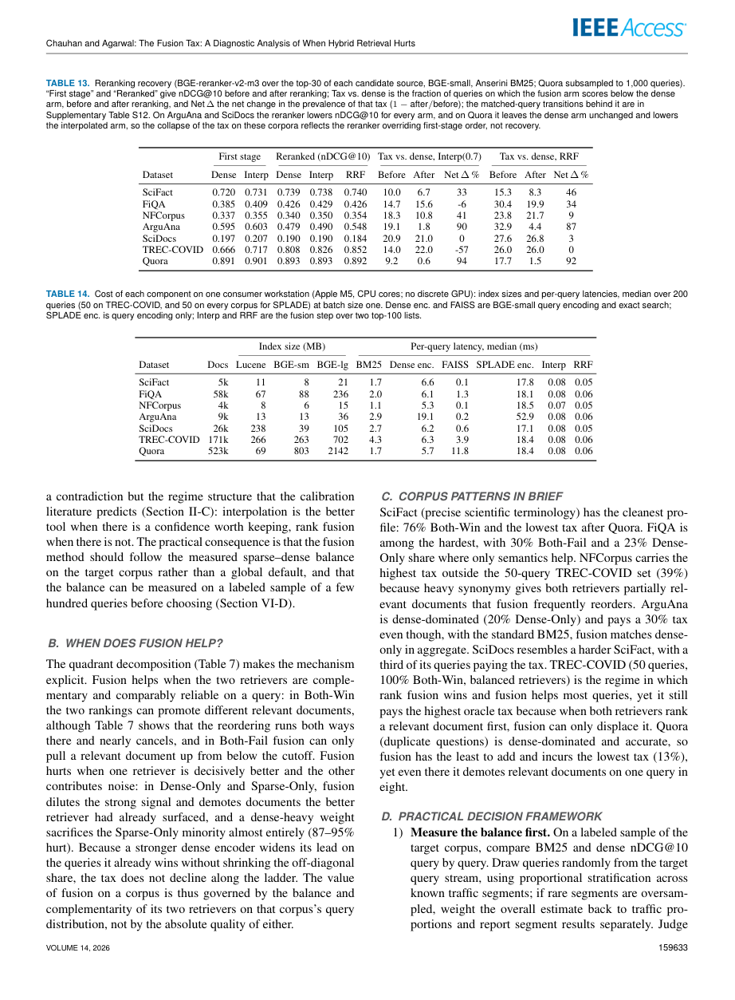

# 已有BM25和重排器，还要加dense融合吗？一次AI读论文到采纳决策的完整实践

这篇分享解决一个具体阅读问题：论文报告混合检索平均变好，是否足以支持已有BM25+cross-encoder的技术文档服务加上dense？问题在于比较对象和下游阶段不同：相对dense的首阶段收益，不能直接回答相对我们既有管线的最终排序收益。

我们使用adoption-review 1.1.0，复用2026年10月23日真实完成的A2-with会话。本次是2026年10月25日整理的独立技术分享，不是新模型实验。案例背景为构造任务，未测量本团队生产流量。本教程不声称Skill优于无Skill、不声称提速，也不执行检索模型训练或部署。

## 先看结论与证据边界

**当前建议：保留既有管线，先做离线验证。** 下表把关键判断与证据对应起来，后文展开实际AI回答、原文位置和复算步骤。

| 要回答的问题 | 已有证据 | 还不能据此确认什么 |
| --- | --- | --- |
| 融合是否优于当前BM25+reranker？ | 所给正文Table13比较的是dense与融合候选重排后的结果 | 缺当前管线的直接比较，尚不能确认本地净收益 |
| 重排后的差值是否都为正？ | 七行复算为−0.001至+0.018，包含两个零值 | 不能遗漏负值，也不能把该范围当成本地收益上界 |
| 400个查询是否足够？ | 在假设SD=0.20的独立配对均值情景下，95%半宽约0.0196 | 实际样本量仍需目标比较的pilot方差及抽样设计 |

这些是既有实践的结论摘要；本次未新增模型运行或生产测量。

## 原论文与真实输入

论文为Aaditya Chauhan、Arun Agarwal的*The Fusion Tax: A Diagnostic Analysis of When Hybrid Retrieval Hurts*，IEEE Access2026；固定arXiv:2610.30612v1，18页。原件与共享依据见[PDF](materials/fusion-tax.pdf)、[署名和CC BY4.0说明](materials/source-and-rights.md)。下文页码均为PDF文件页序。

实际任务全文：

```text
# 任务：已有 reranker 时是否再加混合检索

## 背景

我们的文档检索服务目前是 **BM25 + 一个 cross-encoder reranker**（对候选 top-30 重排；已在生产使用，离线评测显示它在我们语料上稳定提升 nDCG）。用户查询混合了关键词型和自然语言型。第一阶段检索跑在 CPU 上，p95 预算 100 ms；reranker 有自己的 GPU 预算。语料约 50,000 篇技术文档。下游用户逐条阅读前 10 条结果，对排序退步比较敏感。

## 决策问题

是否应该在 reranker 之前再加一个 dense 检索器，并与 BM25 融合？如果加，用什么融合方式、什么权重？上线前先测什么、怎么判定？

## 交付物

`out/report.md`：一份可直接用于评审的中文决策备忘录。要求：

- 给出明确建议（采用 / 有条件采用 / 不采用）与成立条件；
- 关键结论要能让读者回到论文的具体页、表或图；
- 同时说明聚合收益与单查询风险，不要只写“效果更好”；
- 说明成本与部署约束，包括已有 reranker 带来的影响；
- 说明论文没有证明、需要我们自测的部分；
- 给出上线前的测量计划与判定标准。

## 材料

`INPUT/materials/fusion-tax.pdf`：18 页，IEEE Access 2026，CC BY 4.0。不要联网补充材料，也不要用论文之外的资料替代阅读。

## 预算

最多 30 次工具调用、15 分钟。不要向用户提问；材料不足时说明限制并给出有界结果。
```

实际会话指令：

```text
Complete one independent paper-reading task. Read INPUT/task.md and original INPUT materials. Use only this working directory and ordinary installed executables/libraries. Do not inspect parent directories, other sessions, global skills, credentials, history, or evaluation criteria. No network, delegation, publishing or uploading. Do not alter INPUT or supplied skill files. Write artifacts only under out/. Work independently, no questions. Budget: 30 visible command/tool operations, 900 seconds. The Chinese memo out/report.md must be at most 12000 characters. Do not repeat it in the final message; final message at most 120 words. Preserve failed checks before fixes. State limitations if material or budget is insufficient. Do not claim a literal number check proves scientific meaning.
Use the supplied skill/SKILL.md and its helpers.
```

原输入、实际提示、模型/时间/usage和可见工具记录分别保留在[cases/A/task.md](cases/A/task.md)、[prompt](runs/A2-with/prompt.txt)、[session](runs/A2-with/session.json)、[events](runs/A2-with/events.jsonl)、[可见原生导出](runs/A2-with/visible-native.jsonl)。该独立会话使用gpt-6.1-sol标签，用时348.958秒；准确服务端快照和账单未知，不能把input_tokens当作收费token。原始完整报告见[report](runs/A2-with/out/report.md)。

## 方法：先确认要比较谁，再决定读哪里

[冻结Skill](skill/SKILL.md)把三个对象分开：现有系统BM25+reranker；论文主要可部署基线always-dense；候选融合+相同reranker。逐查询oracle需要标签，属于事后参照，也不能当可部署系统。

AI先用triage生成逐页文本和表格导航，然后回读融合定义、实验配置及下游重排实验。完整18页文本在[triage/pages](runs/A2-with/out/triage/pages)，布局文本在[triage/tables](runs/A2-with/out/triage/tables)。这不是强行只读固定几页：比较臂不明确时继续读方法和补充说明，不能用摘要的平均收益替代下游实验。

第5页说明同一BGE-reranker-v2-m3分别重排各候选源的top-30；第14页Table13报告Dense、Interp、RRF重排后结果。表中没有当前BM25+reranker这一直接比较列，正文提到的完整补充表不在提供材料中。因此该PDF不能直接证明我们的候选C优于现有A。未知需要写出来，而不是用另一个比较的均值充当上界。

## 实际AI结论与原文支持分别是什么

下面逐字引自真实AI原报告：

> **建议：有条件采用；目前保留现有管线，只进入离线验证。** 只有融合在相同重排预算下，相对当前生产管线带来有实际价值的最终排序收益，同时满足单查询退步和 CPU 延迟门槛，才值得上线。不能仅凭首阶段平均收益批准，也不能因为已有可靠 reranker 就认定 dense 无价值：它可能补进当前候选集缺失的相关文档，这恰是本地实验要验证的增量。

作者侧核查认为这份条件性结论有依据：原文能说明融合可能带来收益和损失，但不能给出当前构造系统的直接净收益。它也不能证明“不加dense一定最优”。下一步要测C−A与C−B，保持同一重排器、候选预算和展示深度，避免把系统变更产生的其他差异混入。

这里仍有重要边界：我们核对的是论文文字、表格和AI解读，不是复跑原论文的七语料检索实验，也没有作者原始逐查询运行；显著性和本地生产效果未独立验证。

## 全表复算：不要漏掉负值和零值

第14页原图如下。Table13的First stage和Reranked列组必须分开；本次计算Reranked Interp减Reranked Dense。



图源为上述论文，CC BY4.0，保留作者与出处。表头还限定BGE-small、Anserini BM25、top-30和Quora抽取1000查询；这些条件限制外推。

| 语料 | Reranked Dense | Reranked Interp | Interp−Dense |
| --- | ---: | ---: | ---: |
| SciFact | 0.739 | 0.738 | -0.001 |
| FiQA | 0.426 | 0.429 | 0.003 |
| NFCorpus | 0.340 | 0.350 | 0.010 |
| ArguAna | 0.479 | 0.490 | 0.011 |
| SciDocs | 0.190 | 0.190 | 0.000 |
| TREC-COVID | 0.808 | 0.826 | 0.018 |
| Quora | 0.893 | 0.893 | 0.000 |

七行范围为−0.001至+0.018，包含两个零值。它是这组论文配置下的观测差，既不是融合相对我们现有BM25+reranker的收益，也不是通用上界。跨零不能证明等效，显示三位小数也不能支持更高精度的推断。

原始结果为[table13.json](runs/A2-with/out/table13.json)，源布局为[p14.txt](runs/A2-with/out/triage/tables/p14.txt)，调用可复做：

```sh
python3 skill/scripts/table_stats.py --layout runs/A2-with/out/triage/tables/p14.txt --table 13 --columns FirstDense,FirstInterp,RerankDense,RerankInterp,RerankRRF,InterpBefore,InterpAfter,InterpNet,RRFBefore,RRFAfter,RRFNet --rows 7 --diff RerankInterp:RerankDense --out /tmp/table13-recheck.json
```

列名由读者根据原图指定，脚本不会理解表头。它在行数不符、重复名称和列数错误时失败，避免静默取不完整集合。Table8的两种方法共享行名，原AI首次解析失败，随后明确按方法分块并保留原数；不是删掉不利行。该修复保留[失败结果](runs/A2-with/out/table8_failed.json)、[最终布局](runs/A2-with/out/table8_interp_layout.txt)和[完整说明](runs/A2-with/out/failure_notes.md)。

## 从平均提升到个体风险，还差一次对应关系核查

Table13中FiQA的插值受损比例由14.7%变15.6%，TREC-COVID由14.0%变22.0%；后者同时有正的平均差。平均变好与受损比例升高可以同时成立。比较对象仍是dense，不能改写为当前生产管线。

第12页SciFact的匹配查询分析还报告原受损30个中修复27个，同时新增17个。净受损率下降不等于原失败全部消失。下一轮本地测量应保留同一查询的已修复、新受损、仍受损状态，并区分相关文档仍在top-30而排序靠后，与已经被候选截断排除；重排无法补回候选集中不存在的文档。

## 精度计划：把“收集400个查询就够了”变成可核算的假设

原AI保存的[precision_scenario.json](runs/A2-with/out/precision_scenario.json)明确是假设SD=0.20、独立等权配对均值、95%正态近似。公式为h=z×s/√n，给定目标h反推n=ceil((z×s/h)^2)。

```sh
python3 skill/scripts/precision.py --sd 0.20 --n 400 --half-width 0.005 --out /tmp/precision-recheck.json
```

得到n=400时半宽约0.0196，目标0.005需约6147。这个反例说明400不能在上述假设下保证足够窄；6147不是实际流量所需样本数，不是功效分析，也没有处理聚类、分层回权或多重比较。论文中的dense−BM25方差不能拿来代替我们的融合+reranker减BM25+reranker方差。应先在实际比较上pilot估计，再按真正抽样单位规划。

原报告提出的收益、尾部风险和延迟门槛都是建议或题设，不是论文已经验证的常数。现有“篇数”也不等于向量数，表14中位延迟不能相加当作本地p95。因此本次交付是有退出条件的本地验证方案，而不是上线授权。

## 真实失败怎样影响可信度

原会话保留解析失败、首次数字检查失败、修正前报告及修复说明；最终原报告没有被本次重写。完整失败说明如下：

```text
保留的失败与修复：
- table8_failed.json：全表因两方法重复语料行名被助手拒绝；改为按原方法分块，无删行。
- build_evidence_failed.py：初次正文边界截断不精确，行数断言失败；改为在后续正文之前截断。
- table8_interp_failed.json、table8_rrf_failed.json：上游未产出分块文件导致缺文件；保留后复算。
- build_evidence_failed2.py：跨换行的 expensive 结束锚点不匹配；改用原文 not Lucene; 锚点。
- memo_check_failed.json 与 report_before_numeric_fix.md：初稿范围同句引用标签、逐行派生值及负门槛登记不足；补逐行派生证据，拆开数字引用并登记有符号门槛。未改变论文数值来迁就检查。

```

引文检查器只确认短引文在指定页出现、数字和有限算术满足规则，不能确认oracle/静态基线的语义、统计单位或下游比较。原AI另做了[语义核查](runs/A2-with/out/semantic_review.md)；这仍是作者侧AI自查，不是独立人类审稿。

## 读者怎样照做

先按[REPRODUCE.md](REPRODUCE.md)运行`python3 recheck.py`，复核原件哈希、实际引文、全表差及假设精度。这个步骤不调用AI。然后用`python3 prepare_case.py --destination /tmp/fresh-reading-case`准备新目录，在新的工具可调用AI会话使用保存的实际提示；不要提供旧答案。

新回答至少应说清三件事：论文比较的是谁；负值与零值是否保留；测量方差和精度目标对应什么。不能仅因沿用了账本就算成功，也不能要求每个模型同一句措辞。原模型环境、跨平台限制与失败恢复均在复做说明中明确。完整AI重跑没有在本次新增执行。

这份分享的可复用贡献是把“论文平均效果”转换成不偷换比较对象、能核查全表、知道该测什么的决策过程。适用范围是已有系统评估定量方法论文；不据一个案例宣称全学科有效，也不以旧Skill赛道得分预测本赛道成绩。[来源与贡献](SOURCES.md)区分原论文、旧实践与本次教程。
